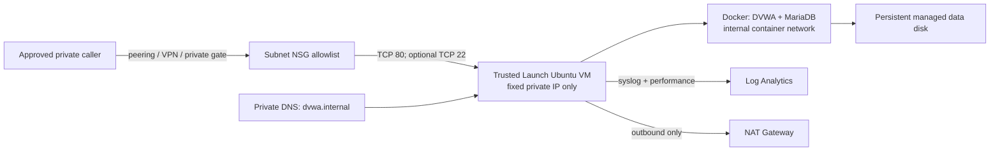

# Private Azure DVWA test server

This Terraform root deploys an intentionally vulnerable DVWA server into the
`BYTEDEFENSE_INFRA_NON_PROD` subscription. Every resource managed by this
Terraform root belongs to `rg-test-server-dvwa` (or is a child association/role
assignment scoped to a resource in that group). A reciprocal peering owned by
an approved consumer VNet is the necessary exception: the deployment tools
reconcile it outside Terraform in that consumer VNet's resource group because
Azure requires a peering resource at both ends.

The VM has no public IP, load balancer, application gateway, or public DNS
record. The only public address is an optional NAT Gateway address used for
outbound package/image retrieval and Azure extensions; NAT Gateway cannot
initiate or forward inbound connections to the VM.

## Deployment shape



Security controls include:

- a blocking subscription-name precondition and fixed resource-group name;
- no inbound public endpoint and a subnet with default outbound access disabled;
- explicit inbound CIDR/ASG allowlists, with deny-all as the last rule;
- explicit outbound service rules, a small bootstrap web rule, and deny-all;
- an internal Docker network by default, so code execution in DVWA cannot
  initiate internet traffic even while the host can retrieve updates;
- a socket-activated host TCP proxy that exposes only the container's HTTP port
  on the private VM while the container stays on that internal-only network;
- Trusted Launch (Secure Boot and vTPM), managed disks, no password login, a
  system-assigned identity, automatic platform patching, Microsoft Entra SSH,
  and VM-scoped RBAC;
- persistent database data separated from disposable compute;
- NVMe/SCSI-aware discovery of data disk LUN 10, UUID-based mounting, and
  mandatory mount checks before Docker or DVWA can start;
- public import/export access disabled on the persistent managed data disk;
- Azure Monitor Agent collection of host syslog/performance and container logs
  sent through the host syslog socket;
- database credentials generated on first boot and stored only on the encrypted
  managed data disk at `/opt/dvwa/.env` with root-only permissions. They never
  enter Terraform configuration, plans, state, or command output.

## Prerequisites

1. Terraform 1.10 or newer, Azure CLI 2.22.1 or newer, and Python 3 for the
   saved-plan storage shutdown check.
2. The Azure resource providers `Microsoft.Authorization`, `Microsoft.Compute`,
   `Microsoft.Insights`, `Microsoft.Network`, and `Microsoft.OperationalInsights`
   registered in `BYTEDEFENSE_INFRA_NON_PROD`.
3. Permission to create the resources and role assignments in the subscription.
4. Private routing between approved callers and `10.70.0.0/16`. This stack can
   create the DVWA-owned half of selected peerings. Manage the reciprocal
   consumer-side peering, VPN/ExpressRoute route, or private gateway from its
   owning stack. Do not expose DVWA through a public listener.

Azure managed disks use platform-managed encryption at rest by default. For
end-to-end encryption of host caches and temporary disks too, register the
`Microsoft.Compute/EncryptionAtHost` subscription feature, confirm the chosen
region/SKU reports `EncryptionAtHostSupported=True`, and set
`encryption_at_host_enabled=true`.

Use either an interactive Azure CLI login or a service principal/workload
identity. Keep credentials in the local environment:

```bash
az login
az account set --subscription "<BYTEDEFENSE_INFRA_NON_PROD subscription UUID>"
export ARM_SUBSCRIPTION_ID="$(az account show --query id --output tsv)"
export TF_VAR_admin_ssh_public_key="$(< ~/.ssh/id_ed25519.pub)"
```

For service-principal authentication, also set `ARM_TENANT_ID`, `ARM_CLIENT_ID`,
and `ARM_CLIENT_SECRET`. Do not put credentials, private keys, or secrets in a
`.tfvars` file. Terraform state contains infrastructure metadata and the SSH
**public** key, but no database password; it must still be protected.

## Configure approved access

Copy the example and replace all placeholder ranges and object IDs:

```bash
cp terraform.tfvars.example terraform.tfvars
```

`application_allowed_source_cidrs` and `ssh_allowed_source_cidrs` default to
empty, so a default deployment accepts no HTTP or SSH sessions. The listed CIDRs
must have a private route to the DVWA VNet. A public `/32` in an NSG does not make
a private VM reachable from the internet.

Application Security Groups may be supplied instead when the callers are Azure
NICs in this VNet. For PaaS VNet integration and peered networks, allow the
integration/subnet CIDR. `approved_remote_vnet_ids` creates only the peering
owned by the DVWA VNet; the consumer-side reciprocal peering stays with the
consumer stack. `additional_private_dns_vnet_links` makes
`dvwa.dvwa.internal` resolvable from selected VNets, but does not create routes.

For normal Microsoft Entra administration, a caller must pass **both** gates:

1. its source CIDR/ASG is present in the SSH allowlist; and
2. its Microsoft Entra object ID is in `vm_admin_principal_ids` (or an approved
   equivalent RBAC assignment is managed elsewhere).

The SSH public key is retained only as break-glass access. That path requires
both possession of the matching private key and passage through the private
network/NSG gate; it does not use the Entra login role. Azure Run Command remains
available through the Azure control plane when SSH is closed, subject to Azure
RBAC.

## Deploy and verify

For the human-friendly deployment pipeline, run one command from the repository
root:

```bash
./infra/deploy.sh
# Equivalent Go Task entrypoint:
task deploy
```

The script logs in/selects the expected subscription, registers providers,
finds or generates an SSH key, discovers the consumer VNet and subnet, writes a
non-secret `terraform.tfvars`, validates and tests Terraform, displays the plan,
applies after one confirmation, reconciles reciprocal peerings, verifies the
guest, and initializes a new DVWA database through Azure Run Command. Use
`./infra/deploy.sh --help` for non-interactive environment inputs and partial
modes.

The staged deployment tools are documented in
[`tools/README.md`](tools/README.md). For the normal first deployment:

```bash
cd infra
./tools/00-check-prerequisites.sh
./tools/01-register-providers.sh
./tools/02-prepare-configuration.sh
# Edit terraform.tfvars before continuing.
./tools/03-validate.sh
./tools/04-plan.sh
./tools/05-apply.sh
./tools/06-create-reciprocal-peering.sh  # only when a consumer VNet is configured
./tools/07-verify.sh
./tools/08-initialize-dvwa.sh            # run from an approved private client
```

The equivalent raw Terraform workflow is retained below for CI systems that
already provide their own guarded orchestration.

```bash
cd infra
terraform init
terraform fmt -check
terraform validate
terraform plan -out=dvwa.tfplan
terraform apply dvwa.tfplan
```

The provider refuses to proceed if the authenticated subscription display name
is not exactly `BYTEDEFENSE_INFRA_NON_PROD`. Review the plan and confirm every
Azure resource is under `rg-test-server-dvwa` before applying.

The checked-in default is `Standard_D2s_v7`, the Trusted Launch-capable SKU
verified to have capacity in `eastus2` during this deployment. Azure capacity is
dynamic; if allocation returns `SkuNotAvailable`, select another Generation 2,
Trusted Launch-capable size only after checking subscription quota and current
regional restrictions.

Bootstrap can take several minutes. Check it without opening SSH:

```bash
az vm run-command invoke \
  --subscription "$ARM_SUBSCRIPTION_ID" \
  --resource-group rg-test-server-dvwa \
  --name vm-test-server-dvwa \
  --command-id RunShellScript \
  --scripts 'set -e; cloud-init status --wait; /usr/local/sbin/dvwa-verify'
```

Successful verification prints `DVWA_DATA_DISK_OK`, `DVWA_DATABASE_HEALTHY`,
the runtime `DEFAULT_SECURITY_LEVEL`, and finally `DVWA_VERIFY_OK`. The host
verification tool checks that final marker because Azure Run Command can report
a successful API call even when the guest script exits unsuccessfully.

## Persistent storage and existing-VM migration

The 32 GB managed disk `disk-dvwa-data` is attached at LUN 10 and mounted at
`/opt/dvwa`. Both `/opt/dvwa/mysql` and the root-only `/opt/dvwa/.env` belong on
that disk. Bootstrap uses `/dev/disk/azure/data/by-lun/10` on NVMe hosts, with
`/dev/disk/azure/scsi1/lun10` as a compatibility fallback. It accepts an existing
unmounted ext4 filesystem, initializes only an unpartitioned disk with no
recognized signatures, and refuses mounted disks, unexpected filesystems, or
disk-inspection errors. An existing OS-disk `/opt/dvwa` directory is never
silently hidden by a new mount.

The mount is persisted in `/etc/fstab` using its filesystem UUID. `nofail`
keeps the VM administrable when the data disk is unavailable; systemd
`RequiresMountsFor=/opt/dvwa` plus a mountpoint check prevent Docker and DVWA
from starting without it. Docker needs its own dependency because container
restart policies otherwise bypass the DVWA service.

For a legacy deployment that has database files on its OS disk:

1. Take a protected snapshot of the OS disk for rollback.
2. Install `guest/prepare-storage.sh`, `guest/verify.sh`, and
   `guest/migrate-storage.sh` on the VM as `/usr/local/sbin/dvwa-prepare-storage`,
   `/usr/local/sbin/dvwa-verify`, and `/usr/local/sbin/dvwa-migrate-storage`,
   respectively, owned by root with mode `0700`. Ensure `rsync` is installed.
3. Run `/usr/local/sbin/dvwa-migrate-storage` as root during a maintenance window.
   It creates a private logical database dump, stops the app/database/Docker,
   copies data with numeric ownership and metadata intact, verifies the copy
   using checksums, configures the UUID mount and service dependencies, and
   starts and verifies the application.
4. Require `DVWA_STORAGE_MIGRATED` before applying a VM replacement. The
   original files remain at `/opt/dvwa.os-backup.<UTC timestamp>` on the old OS
   disk, and the logical dump is retained under `/opt/dvwa/recovery` on the
   managed data disk. Keep the OS snapshot until the replacement is verified.

The migration refuses a nonempty destination disk. If it fails, inspect its
output before retrying; services may intentionally remain stopped and the
original files are retained. Never run database initialization/reset to repair
a mount problem. Changing cloud-init replaces the VM through Terraform, so
migrate and verify legacy data **before** applying that plan. Do not delete the
retained data disk or run `terraform destroy` as part of this repair.

Use `tools/05-apply.sh` for replacements and compute removal. It stops database
writers and unmounts the data disk before Terraform detaches it. If apply fails
after that step, leave the app stopped until the disk attachment is inspected;
remount and start the services only when the correct data disk is attached.
Raw `terraform apply` bypasses this guest shutdown protection.

From an approved, privately routed client, resolve and open:

```text
http://dvwa.dvwa.internal
```

There is deliberately no HTTPS termination in this stack because there is no
public edge and DVWA is a disposable attack target. If traffic crosses a shared
or untrusted private network, place an approved private reverse proxy/gateway in
front of it and remove direct caller CIDRs from the port 80 allowlist.

## Browser access without a VPN (Azure Bastion tunnel)

When no corporate VPN, ExpressRoute, or peered consumer VNet is available, Azure
Bastion provides an interactive path from a workstation. Bastion reaches the
VM's fixed private IP through the Azure control plane, so it needs no public IP
on the VM and no GUI jumpbox. Bastion is **not** part of this Terraform stack;
add it out of band for a review session and remove it afterwards to avoid
standing cost.

Bastion terminates its own management HTTPS on a public IP attached to the
Bastion host, not to the VM. The VM NIC still has no public IP, so the
`07-verify.sh` security invariant continues to hold and no inbound internet path
to DVWA's services is created.

Native-client port forwarding requires the **Standard** SKU (or higher) with
tunneling enabled. The Basic and Developer SKUs cannot forward arbitrary ports.

1. Select the protected subscription, export its actual ID for every following
   command, and install or upgrade the Azure CLI Bastion extension:

   ```bash
   az account set --subscription "BYTEDEFENSE_INFRA_NON_PROD"
   export ARM_SUBSCRIPTION_ID="$(az account show --query id --output tsv)"
   az extension add --name bastion --upgrade
   ```

2. Add the dedicated Bastion subnet to the VNet. It must be named exactly
   `AzureBastionSubnet`, sized /26 or larger, and carved from the VNet address
   space. Do not associate the VM NSG with it; Bastion manages its own subnet
   rules.

   ```bash
   az network vnet subnet create \
     --subscription "$ARM_SUBSCRIPTION_ID" \
     --resource-group rg-test-server-dvwa \
     --vnet-name vnet-test-server-dvwa \
     --name AzureBastionSubnet \
     --address-prefixes 10.70.2.0/26
   ```

3. Allow the Bastion subnet to reach DVWA. Bastion connects from the
   `AzureBastionSubnet` range, so add that CIDR to
   `application_allowed_source_cidrs` and apply. **Append** the Bastion CIDR to
   the existing list; never replace the AppSec or Ept entries. For the current
   environment the complete list is:

   ```hcl
   application_allowed_source_cidrs = [
     "10.80.2.0/23", # AppSec
     "10.90.2.0/23", # Ept
     "10.70.2.0/26", # temporary Azure Bastion session
   ]
   ```

   From `infra`, review and apply that allowlist-only change:

   ```bash
   ./tools/04-plan.sh
   ./tools/05-apply.sh
   ```

4. Deploy a Standard Bastion host with tunneling enabled into that subnet:

   ```bash
   az network public-ip create \
     --subscription "$ARM_SUBSCRIPTION_ID" \
     --resource-group rg-test-server-dvwa --name pip-dvwa-bastion \
     --sku Standard --allocation-method Static

   az network bastion create \
     --subscription "$ARM_SUBSCRIPTION_ID" \
     --resource-group rg-test-server-dvwa --name bastion-dvwa \
     --vnet-name vnet-test-server-dvwa \
     --public-ip-address pip-dvwa-bastion \
     --location eastus2 --sku Standard --enable-tunneling true
   ```

5. Open a local tunnel to the DVWA web port:

   From the repository root, the task wrapper resolves the VM resource ID and
   runs the same Azure CLI tunnel command in the foreground:

   ```bash
   task bastion:tunnel
   # Alias: task bastion:open
   ```

   Use `task bastion:tunnel -- --local-port 8081` or set
   `DVWA_BASTION_LOCAL_PORT` when port 8080 is unavailable. Leave the task
   running and press Ctrl-C to close the tunnel.

   The equivalent raw Azure CLI commands are:

   ```bash
   vm_id="$(az vm show \
     --subscription "$ARM_SUBSCRIPTION_ID" \
     --resource-group rg-test-server-dvwa \
     --name vm-test-server-dvwa --query id --output tsv)"

   az network bastion tunnel \
     --subscription "$ARM_SUBSCRIPTION_ID" \
     --resource-group rg-test-server-dvwa --name bastion-dvwa \
     --target-resource-id "${vm_id}" \
     --resource-port 80 --port 8080
   ```

   Leave that command running. In a second shell, verify the private app through
   the local endpoint before opening `http://localhost:8080` in a browser:

   ```bash
   curl -fsSL --max-time 30 http://127.0.0.1:8080/login.php \
     | grep -Fq 'Damn Vulnerable Web Application'
   ```

   A zero exit status confirms that the DVWA login page is responding through
   Bastion. The normal deployment pipeline initializes the database. Run
   Create / Reset Database only if deployment reported that initialization was
   skipped or failed; it is destructive to existing DVWA data. To recover
   through the Azure control plane without private client routing, use:

   ```bash
   ./infra/tools/08-initialize-dvwa.sh --via-run-command
   ```

To tunnel SSH instead of HTTP, add the Bastion subnet to
`ssh_allowed_source_cidrs`, tunnel `--resource-port 22 --port 2222`, then
`ssh -L 8080:localhost:80 -p 2222 azureadmin@localhost` and browse
`http://localhost:8080`.

When the session ends, stop the tunnel with Ctrl-C and remove every temporary
Bastion component. Delete the Bastion host before its public IP and subnet:

```bash
az network bastion delete --subscription "$ARM_SUBSCRIPTION_ID" \
  --resource-group rg-test-server-dvwa --name bastion-dvwa --yes
az network public-ip delete --subscription "$ARM_SUBSCRIPTION_ID" \
  --resource-group rg-test-server-dvwa --name pip-dvwa-bastion
az network vnet subnet delete --subscription "$ARM_SUBSCRIPTION_ID" \
  --resource-group rg-test-server-dvwa \
  --vnet-name vnet-test-server-dvwa --name AzureBastionSubnet
```

Finally, remove **only** `10.70.2.0/26` from
`application_allowed_source_cidrs` in `terraform.tfvars` (preserve the AppSec
and Ept entries), then run `./tools/04-plan.sh` and `./tools/05-apply.sh` from
`infra`. This restores the steady-state HTTP allowlist and avoids both standing
Bastion cost and an unused access rule.

## Activate and deactivate

Use Azure power controls for routine operation. Deallocation stops compute
billing and keeps the VM, private address, OS disk, data disk, and configuration:

```bash
az vm deallocate --subscription "$ARM_SUBSCRIPTION_ID" --resource-group rg-test-server-dvwa --name vm-test-server-dvwa
az vm start      --subscription "$ARM_SUBSCRIPTION_ID" --resource-group rg-test-server-dvwa --name vm-test-server-dvwa
```

Terraform does not model a desired VM power state. A later `terraform apply`
does not substitute for the explicit `az vm start` command.

For a longer inactive period, set `vm_deployed = false` and apply. Terraform
removes the VM, NIC, extensions, role assignments, DNS record, NAT gateway, and
NAT public IP. It retains the resource group, VNet/subnet/NSG, private DNS zone,
Log Analytics workspace/DCR, ASG, and persistent data disk. Set it back to
`true` and apply to rebuild the VM and reattach the database disk.

## Egress containment and updates

The default host egress permits Azure platform services plus TCP/80 and TCP/443
to `Internet` through the outbound-only NAT gateway. The web rule is needed for
Ubuntu updates and OCI image pulls. NSGs cannot restrict this traffic by FQDN.
For tighter enterprise egress, route the subnet through the existing inspected
hub/Azure Firewall and replace the Internet rule with approved FQDN rules.

The DVWA and MariaDB containers use an internal Docker network by default, so
they cannot use that host egress path. Set
`container_internet_access_enabled=true` only for a test that explicitly needs
outbound callbacks and return it to `false` afterward. Changing this value
replaces the VM because cloud-init is immutable.

`nat_gateway_enabled=false` creates a fully non-routable private subnet, but a
fresh VM then cannot install Docker, pull images, install Entra SSH, or send
monitoring data unless equivalent private endpoints/package mirrors already
exist. Do not disable NAT before designing those dependencies.

## Destruction

`terraform destroy` removes the persistent data disk and its database. Use
`vm_deployed=false` for reversible compute removal. Back up anything needed from
the data disk before a full destroy.
